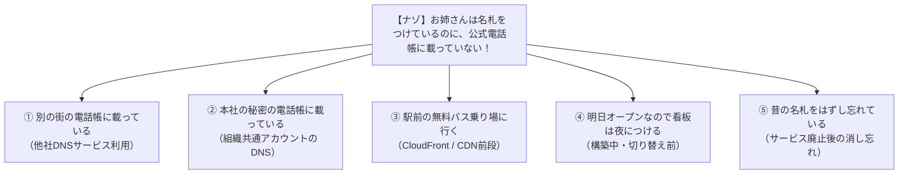
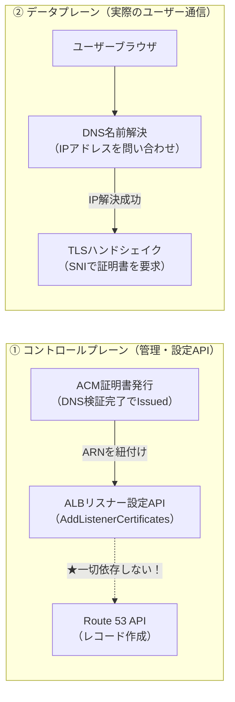
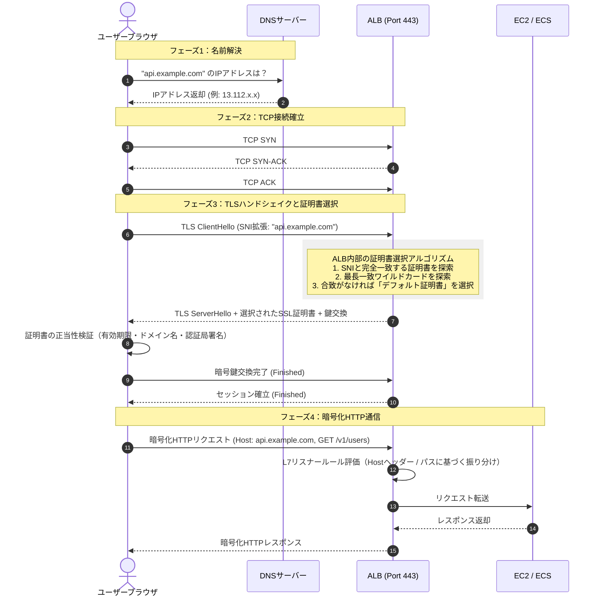
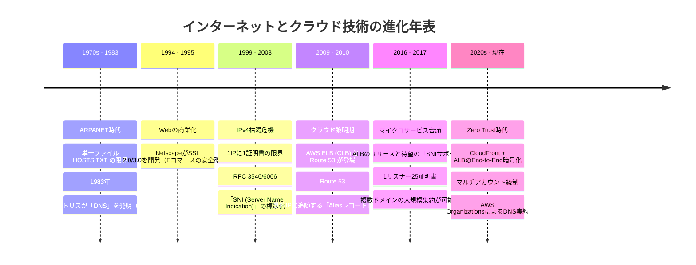
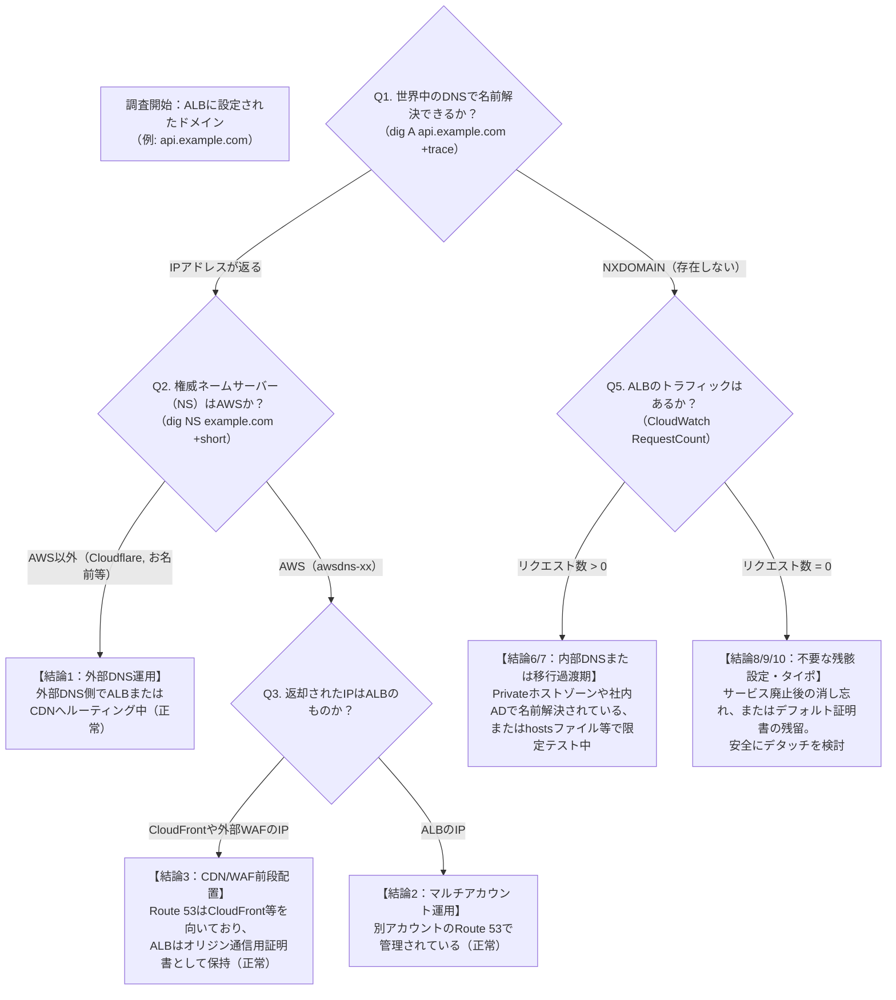

# ALBのSSL証明書に設定されているドメインがRoute 53に未登録である事象の総合分析・技術解説書

---

## 目次

1. [はじめに：何が起きているのか？](#1-はじめに何が起きているのか)
2. [小学生でも1分でわかる！たとえ話で理解する全体像](#2-小学生でも1分でわかるたとえ話で理解する全体像)
   - [登場人物の整理（IT用語と身近なたとえ）](#登場人物の整理it用語と身近なたとえ)
   - [事件の構図：名札はあるのに住所録に載っていない！？](#事件の構図名札はあるのに住所録に載っていない)
   - [身近なたとえで納得する5大理由](#身近なたとえで納得する5大理由)
3. [考えられる10の可能性・詳細解説マトリクス](#3-考えられる10の可能性詳細解説マトリクス)
   - [可能性1：他社DNSサービス（Cloudflare, お名前.com等）を利用している](#可能性1他社dnsサービスcloudflare-お名前com等を利用している)
   - [可能性2：マルチアカウント構成（共通Network/DNSアカウントに集約）](#可能性2マルチアカウント構成共通networkdnsアカウントに集約)
   - [可能性3：CloudFront等のCDNが前段に配置されている（オリジン間暗号化）](#可能性3cloudfront等のcdnが前段に配置されているオリジン間暗号化)
   - [可能性4：SaaS型WAF（Akamai, Imperva等）が前段に配置されている](#可能性4saas型wafakamai-imperva等が前段に配置されている)
   - [可能性5：社内限定・プライベートホストゾーン（PHZ）またはオンプレミスDNS](#可能性5社内限定プライベートホストゾーンphzまたはオンプレミスdns)
   - [可能性6：ワイルドカード証明書またはSAN（マルチドメイン）証明書の一角](#可能性6ワイルドカード証明書またはsanマルチドメイン証明書の一角)
   - [可能性7：新規構築中・移行中・Blue/Greenデプロイ準備中（DNS切替前）](#可能性7新規構築中移行中bluegreenデプロイ準備中dns切替前)
   - [可能性8：サービス廃止後の消し忘れ（ゾンビ設定・ゴースト証明書）](#可能性8サービス廃止後の消し忘れゾンビ設定ゴースト証明書)
   - [可能性9：ALB仕様上のデフォルト証明書（フォールバック用）として残存](#可能性9alb仕様上のデフォルト証明書フォールバック用として残存)
   - [可能性10：ドメイン名のタイポ（スペルミス）または誤ったホストゾーン参照](#可能性10ドメイン名のタイポスペルミスまたは誤ったホストゾーン参照)
4. [動作原理と通信メカニズムの深堀り](#4-動作原理と通信メカニズムの深堀り)
   - [なぜ「Route 53にレコードがないのにALBに証明書が設定できる」のか？](#なぜroute-53にレコードがないのにalbに証明書が設定できるのか)
   - [ACMのドメイン所有権検証（DNS検証）の独立メカニズム](#acmのドメイン所有権検証dns検証の独立メカニズム)
   - [TLSハンドシェイクとALBのSNI（Server Name Indication）選択アルゴリズム](#tlsハンドシェイクとalbのsniserver-name-indication選択アルゴリズム)
   - [DNS名前解決とHTTP通信の完全シーケンス](#dns名前解決とhttp通信の完全シーケンス)
5. [登場の歴史と背景・必要になった経緯](#5-登場の歴史と背景必要になった経緯)
   - [1970年代〜1983年：HOSTS.TXTの手動配布から階層型分散DNSへ](#1970年代1983年hoststxtの手動配布から階層型分散dnsへ)
   - [1994年〜1995年：Eコマースの幕開けとNetscapeによるSSL誕生](#1994年1995年eコマースの幕開けとnetscapeによるssl誕生)
   - [1999年〜2003年：IPv4枯渇危機とSNI（RFC 3546/6066）の発明](#1999年2003年ipv4枯渇危機とsnirfc-35466066の発明)
   - [2009年〜2010年：AWS ELB(CLB)とRoute 53の登場、エイリアスレコードの革新](#2009年2010年aws-elbclbとroute-53の登場エイリアスレコードの革新)
   - [2016年〜2017年：ALBの誕生とSNIサポート（1台のロードバランサーへの集約）](#2016年2017年albの誕生とsniサポート1台のロードバランサーへの集約)
   - [2020年代〜現在：Zero Trust・マルチCDN・マルチアカウント統制の時代へ](#2020年代現在zero-trustマルチcdnマルチアカウント統制の時代へ)
6. [現場で使える実践トラブルシューティング手順書](#6-現場で使える実践トラブルシューティング手順書)
   - [原因特定フローチャート](#原因特定フローチャート)
   - [即座に実行できる調査コマンド集（dig / openssl / aws cli）](#即座に実行できる調査コマンド集dig--openssl--aws-cli)
7. [まとめと推奨アクション](#7-まとめと推奨アクション)

---

## 1. はじめに：何が起きているのか？

AWS環境を調査していると、以下のような構成に遭遇することがあります。

```
[AWSマネジメントコンソール / IaCコード]
・ALB（Application Load Balancer）のHTTPSリスナー（Port 443）を確認
・SSL/TLS証明書（ACM証明書）として「api.example.com」が設定されている
・しかし、AWS Route 53のホストゾーン一覧を開いても「api.example.com」のレコードが存在しない
（あるいは「example.com」というホストゾーン自体が見当たらない）
```

一見すると「設定ミスではないか？」「通信できないのではないか？」と不安になる構成ですが、**実は現代のエンタープライズクラウド環境においては、極めて合理的かつ正常な設計であるケースが非常に多く存在します。**

本書では、この現象が発生する背景・動作原理・歴史的経緯・10の可能性を、小学生にもわかる平易なたとえ話から、プロのインフラエンジニア向けの技術深堀りまで徹底的に解説します。

---

## 2. 小学生でも1分でわかる！たとえ話で理解する全体像

難解なIT用語を、身近な「デパート」にたとえてみましょう。

### 登場人物の整理（IT用語と身近なたとえ）

| IT用語 | 身近なたとえ | 役割とイメージ |
| :--- | :--- | :--- |
| **ALB (ロードバランサー)** | 巨大デパートの**「総合案内所のお姉さん」** | お客さんがやってきたら、「お洋服売り場は2階へ」「レストランは最上階へ」とスムーズに案内する受付スタッフ。 |
| **SSL/TLS 証明書 (ACM)** | 首から下げた**「キラキラの公式身分証（名札）」** | 「私は本物の『ひまわりデパート』公認の案内係です！偽物ではありません」と証明するカード。これがないと怪しまれて誰も入ってくれません。 |
| **Route 53 (DNSサービス)** | 街の公式**「電話帳・住所録（104番）」** | 「ひまわりデパートに行きたいなら、駅前通り5丁目を右に曲がってね」と場所（住所/IPアドレス）を教えてくれる案内帳。 |

### 事件の構図：名札はあるのに住所録に載っていない！？

今回の状況は、まさに以下のミステリーです。

> **「案内所のお姉さんは『ひまわりデパート』の公式名札（SSL証明書）を誇らしげにつけて立っているのに、街の公式電話帳（Route 53）をめくっても『ひまわりデパート』の名前も住所も載っていない！？」**

「そんなのおかしい！お姉さんは偽物なの？デパートに行けないの？」と思うかもしれません。しかし、現実の社会でも以下のような理由があれば、何もおかしくありません。

### 身近なたとえで納得する5大理由



1. **別の街の電話帳に載っている（外部DNS利用）**
   - 街の公式電話帳ではなく、「民間の電話帳」や「世界共通の住所録」に載せているから。お客さんはそちらを見てデパートにやってきます。
2. **本社の秘密の電話帳に載っている（マルチアカウント構成）**
   - 支店のお店には電話帳が置いておらず、本社の大きなお部屋にある「会社全体の巨大住所録」にだけ載っているから。
3. **駅前の無料シャトルバスに乗る（CloudFront / CDN前段配置）**
   - お客さんはデパートに歩いて直接行かず、駅前の「高速シャトルバス」に乗って行きます。そのため、街の案内看板はデパートではなく「バス乗り場」を指しています。
4. **明日オープンなので看板は夜につける（構築中・切り替え前）**
   - お店もお姉さんの名札も準備万端だけど、グランドオープンの明日までは電話帳に載せない計画だから。
5. **昔の名札をはずし忘れている（消し忘れ・残骸）**
   - 昔そのお店だったけれど、今は別のお店になった。看板は外したのに、お姉さんが昔の名札を名札立てに差しっぱなしにしていたから。

---

## 3. 考えられる10の可能性・詳細解説マトリクス

ここからは、現役のインフラエンジニア・クラウドアーキテクトが遭遇するリアルな可能性を10項目に網羅して比較・解説します。

| No | 分類カテゴリ | シナリオ名 | 発生頻度 | なぜALBに証明書があるのか？ | なぜRoute 53にレコードがないのか？ | 正常/異常 | 実務での典型例 |
| :-: | :--- | :--- | :-: | :--- | :--- | :-: | :--- |
| **1** | **外部DNS** | 他社DNS（Cloudflare/お名前等）を利用 | **極めて高** | 外部DNSでACMのDNS検証用CNAMEを登録して証明書を発行し適用。 | ドメインの権威DNSがRoute 53ではなく外部DNSにあり、外部側でALBへCNAME。 | **正常** | ドメイン管理を一括してCloudflareやお名前.com等に集約している企業。 |
| **2** | **マルチアカウント** | 組織共通DNSアカウントに集約 | **極めて高** | ALBが存在するサービスアカウント内でACM証明書を発行・適用。 | Route 53パブリックホストゾーンは共通Networkアカウントにあり、作業アカウントにない。 | **正常** | AWS OrganizationsやControl Towerを導入した大規模環境の標準設計。 |
| **3** | **CDN前段配置** | CloudFront + ALB（End-to-End暗号化） | **極めて高** | CloudFront〜ALB間の通信をHTTPSで安全に保護するため証明書が必要。 | Route 53レコードは「CloudFront」を向いており、ALBへ直接向けるレコードはない。 | **正常** | 静的キャッシュ、WAF、DDoS対策でCloudFrontを前段に置くWebシステム。 |
| **4** | **外部WAF/CDN** | SaaS型WAF（Akamai/Imperva等）経由 | **中〜高** | WAFプロキシからALB間のTLS通信を暗号化・SNI検証するために必要。 | DNSはWAFのエッジIP/CNAMEを向いており、ALBへの直接レコードは非公開。 | **正常** | 金融機関やエンタープライズで全社統一WAFとしてAkamai等を導入している場合。 |
| **5** | **閉域・社内DNS** | プライベートホストゾーンまたは社内AD | **中** | 社内アクセスでもブラウザのSSL警告を出さないため正規証明書を設定。 | パブリックには一切レコードを作らず、特定VPC紐付けPHZや社内DNSにある。 | **正常** | 社内業務システム、管理画面、マイクロサービスのバックエンドAPI。 |
| **6** | **証明書仕様** | ワイルドカードまたはSAN証明書の一角 | **高** | 1枚の証明書で将来のサブドメインもカバーするためALBに適用。 | Route 53には現在稼働中のサブドメインしか作っておらず、未稼働ドメインはない。 | **正常** | `*.example.com` を取得し、一部のサブドメインのみ稼働させているケース。 |
| **7** | **構築フェーズ** | リリース前・移行中（DNS切替前） | **中** | ALB・ECS・ACM証明書を先行構築してインフラの事前テストを実施中。 | 本番DNSの切り替え（DNSカットオーバー）前のため、Route 53は未変更。 | **正常** | 新規サービスのローンチ前、またはオンプレミスからのクラウド移行作業中。 |
| **8** | **構成不備・残骸** | サービス廃止後の消し忘れ（ゾンビ設定） | **中** | 以前そのドメインで運用していたが、サービス終了時にALB側を放置。 | DNSレコードは削除されたが、ALBリスナーの追加証明書から外し忘れた。 | **要対応** | 開発環境のスクラップ＆ビルド後や、退職者が残した不要な設定。 |
| **9** | **ALB仕様制約** | デフォルト証明書として残存 | **中〜低** | ALB HTTPSリスナーは仕様上、最低1つの「デフォルト証明書」が必須。 | 実際の運用はSNIで後から追加した別証明書で行われており、初期証明書は不使用。 | **整理推奨** | ALB作成時に適当な証明書を選び、後から本番用証明書を追加したケース。 |
| **10** | **ヒューマンエラー** | タイポ（スペルミス）やホストゾーン違い | **低〜中** | 証明書リクエスト時にドメイン名を打ち間違えたままアタッチした。 | 正しいドメインを探しているが、そもそも証明書側の文字列が間違っている。 | **異常** | 手動コンソール構築やIaCのパラメータ定義誤りによるもの。 |

---

### 各可能性の深掘り解説

#### 可能性1：他社DNSサービス（Cloudflare, お名前.com等）を利用している
- **背景と現場実態**:
  ドメインの購入・管理を行っているレジストラ（お名前.com, GoDaddy等）や、エッジセキュリティとしてCloudflareを導入している企業では、DNSの権威サーバー（NSレコード）をAWS Route 53に移管せず、外部DNSのまま運用することが極めて一般的です。
- **なぜALBに証明書があるのか？**:
  AWS Certificate Manager (ACM) で証明書を発行する際、「DNS検証」を選択すると検証用CNAME（`_xxxx.example.com CNAME _yyyy.acm-validations.aws.`）が発行されます。これを外部DNS側の管理画面に登録すれば、ACMは「ドメインの所有者である」と認定し、正規のパブリックSSL証明書を発行します。ALBはその証明書を紐付けているだけです。
- **なぜRoute 53にレコードがないのか？**:
  ドメインの名前解決はすべて外部DNS側で行われており、外部DNS側で `api.example.com CNAME xxxx.elb.amazonaws.com` と設定されているため、Route 53を使う必要が一切ないからです。

#### 可能性2：マルチアカウント構成（共通Network/DNSアカウントに集約）
- **背景と現場実態**:
  AWS OrganizationsやAWS Control Towerを活用する企業では、セキュリティ統制の観点から「マルチアカウント戦略」を採用します。
  - `Shared Services / Network Account`: ドメイン管理、Route 53パブリックホストゾーン、Transit Gatewayなどを一元管理。
  - `Workload / Application Account`: 各システム（ECS, EKS, EC2, ALB）を配置。
- **なぜALBに証明書があるのか？**:
  Workloadアカウント内のALBがHTTPSを受けるため、そのアカウント内のACMで証明書を発行し適用しています。
- **なぜRoute 53にレコードがないのか？**:
  現在ログインしている作業アカウントにはRoute 53ホストゾーンがなく、親や共通の「Networkアカウント」側のRoute 53にALBへのエイリアスレコードが登録されているためです。

#### 可能性3：CloudFront等のCDNが前段に配置されている（オリジン間暗号化）
- **背景と現場実態**:
  Webサイトの高速化、DDoS対策（AWS Shield）、WAFルールの適用をエッジで行うため、ユーザーからのアクセスは「CloudFront」が受けます。
- **なぜALBに証明書があるのか？**:
  CloudFrontからオリジンであるALBへの通信（オリジン通信）をHTTPSで暗号化するため（End-to-End暗号化のセキュリティ要件）。CloudFrontはHostヘッダーをオリジンに転送するため、ALB側にも同一ドメインの正規SSL証明書が必須となります。
- **なぜRoute 53にレコードがないのか？**:
  Route 53のドメインレコード（ALIASレコード）は「CloudFrontディストリビューション（`xxxx.cloudfront.net`）」を向いているため、ALBへ直接向くレコードは存在しません。

---

## 4. 動作原理と通信メカニズムの深堀り

### なぜ「Route 53にレコードがないのにALBに証明書が設定できる」のか？

根本的な理由は、**「コントロールプレーン（管理操作）」と「データプレーン（実際の通信）」が完全に独立している**ためです。



AWSの内部API（コントロールプレーン）において、ALBリスナーに証明書をアタッチする際、**「そのドメイン名が現在Route 53でALBに向けられているか？」という検証は一切行われません。**
ALBのAPIが行うのは、「指定されたACM証明書が有効なステータス（Issued）であるか」の確認のみです。

### ACMのドメイン所有権検証（DNS検証）の独立メカニズム

ACMのDNS検証は、世界中のどの権威DNS（Route 53、Cloudflare、BIND、Active Directory等）であっても成立します。

1. ユーザーがACMに `api.example.com` の証明書をリクエスト。
2. ACMが所有権検証用のランダムなCNAMEレコード情報を発行：
   ```text
   名前: _a7b8c9d0.api.example.com.
   値:   _x1y2z3.acm-validations.aws.
   ```
3. ユーザーがこのCNAMEを自社が利用している権威DNSに登録。
4. AWSの検証サーバーが世界分散DNSを通じてこのCNAMEを正引き。値が一致すれば「ドメイン所有者である」と判定し、証明書を【Issued（発行済み）】にする。
5. **この検証プロセスにおいて、Route 53を使う必要性は1ミリもありません。**

---

### TLSハンドシェイクとALBのSNI（Server Name Indication）選択アルゴリズム

ALBに複数の証明書が設定されている場合、ALBはクライアントが送信する「SNI（Server Name Indication）」ヘッダーを読み取り、最適な証明書を動的に選択して返却します。



#### ALBの証明書評価ロジック（優先順位）
1. **完全一致 (Exact Match)**: リスナーに登録された証明書のCNまたはSANに、クライアントのSNI（`api.example.com`）と完全に一致するものがあれば最優先で選択。
2. **最長一致ワイルドカード (Longest Wildcard Match)**: 完全一致がない場合、`*.example.com` のようなワイルドカード証明書を選択。
3. **デフォルト証明書 (Fallback Default Certificate)**: どの証明書にもマッチしない場合、リスナー作成時に指定した「デフォルト証明書」を返却。

---

## 5. 登場の歴史と背景・必要になった経緯

なぜ現代のような「ロードバランサーに複数の証明書が集約され、DNSと証明書が別々に運用される」複雑な仕組みが生まれたのでしょうか？その技術進化の軌跡を振り返ります。



### 1. 1970年代〜1983年：HOSTS.TXTの手動配布から階層型分散DNSへ
- **当時の課題**: インターネットの前身であるARPANETでは、スタンフォード研究所（SRI）が「HOSTS.TXT」という1つのテキストファイルに全コンピューターの名前とIPアドレスを手作業で書き込み、全員がFTPでダウンロードしていました。コンピューター数が数千台を超えると更新頻度とネットワーク負荷で破綻寸前になりました。
- **ブレイクスルー**: 1983年、ポール・モカペトリスが**「DNS（Domain Name System）」**を考案。ツリー構造による階層型・自律分散データベースにより、「各組織が自分のドメインの住所録を世界中に分散して管理する」大原則が確立しました。Route 53も、この世界分散DNSの1つの権威サーバーに過ぎません。

### 2. 1994年〜1995年：Eコマースの幕開けとNetscapeによるSSL誕生
- **当時の課題**: Webブラウザ（Netscape Navigator）の普及により、インターネット上でクレジットカード決済や個人情報をやり取りする商業利用が急拡大。通信が平文（HTTP）のままでは、盗聴・改ざん・なりすましが横行しました。
- **ブレイクスルー**: Netscape社が**「SSL（Secure Sockets Layer）」**を開発。「暗号化」「改ざん検知」「証明書によるサーバー認証」をワンセットで提供し、現代のHTTPS通信の土台となりました。

### 3. 1999年〜2003年：IPv4枯渇危機とSNI（RFC 3546/6066）の発明
- **当時の課題**: 従来のSSL/TLSは、TCP接続確立の直後に暗号化ハンドシェイクを開始するため、「クライアントがどのドメインにアクセスしたいのか」が暗号化前に分かりませんでした。そのため、**「1つのグローバルIPアドレスに対して、1つのSSL証明書しか返せない」**という致命的な制約がありました。複数のWebサイトを1台のサーバーで相乗りさせる（バーチャルホスト）には、サイトごとに異なるIPv4アドレスを割り当てる必要があり、IPv4アドレスの枯渇を激しく加速させました。
- **ブレイクスルー**: RFC 3546 / RFC 6066で**「SNI（Server Name Indication）」**が策定。TLSハンドシェイクの最初のパケット（ClientHello）に「アクセス先ホスト名」を平文で含める拡張仕様が導入されました。これにより、**「単一のIPアドレスで複数の異なるSSL証明書を使い分ける」**ことが可能になりました。

### 4. 2009年〜2010年：AWS ELB(CLB)とRoute 53の登場、エイリアスレコードの革新
- **当時の課題**: クラウド上で仮想サーバー（EC2）が動的にスケールアウトする時代になり、ロードバランサーのIPアドレスも動的に変動するようになりました。しかしDNS標準規格（RFC 1034）では、Apexドメイン（`example.com` などサブドメインなし）にCNAMEレコードを設定することが禁止されており、動的IPを持つELBにApexドメインを向けることができませんでした。
- **ブレイクスルー**: 2010年にRoute 53が登場。独自の**「Aliasレコード（エイリアスレコード）」**を発明し、DNS規格の制約を回避しながら、AWSリソースの動的DNS名へ直接ルーティング可能にしました。

### 5. 2016年〜2017年：ALBの誕生とSNIサポート（1台のロードバランサーへの集約）
- **当時の課題**: 従来のClassic Load Balancer (CLB) はSNIに未対応（または極めて限定的）で、異なるドメインのHTTPSサイトをホストするには、ドメインごとに高額なロードバランサーを何台も立ち上げる必要がありました。
- **ブレイクスルー**: 2016年にL7特化型のALB（Application Load Balancer）が登場し、2017年に**「SNI複数証明書サポート（最大25個）」**が追加されました。1台のALBに社内用・社外用・別事業部用など多数の証明書を共存させることが可能になり、大幅なコスト削減が実現しました。この進化こそが、今回の「1つのALBに様々なドメインが相乗りし、一部のドメインレコードが手元のRoute 53に見当たらない」状況を生み出す技術的背景です。

### 6. 2020年代〜現在：Zero Trust・マルチCDN・マルチアカウント統制の時代へ
- **最新トレンド**: 「境界防御（社内ネットワークは安全）」という考え方が崩壊し、社内通信も含めてすべての通信を暗号化する「Zero Trust」が主流化。CloudFrontやWAFなどのエッジプロキシと、バックエンドのALBとの間も完全HTTPS化することがセキュリティ監査の必須条件となりました。
- また、大規模組織ではAWS Organizationsによる「NetworkアカウントへのDNS集約」が標準となり、**「ALBがあるAWSアカウントと、DNSレコードがあるAWSアカウントが完全に分かれている」**構成が日常茶飯事となっています。

---

## 6. 現場で使える実践トラブルシューティング手順書

### 原因特定フローチャート



---

### 即座に実行できる調査コマンド集（dig / openssl / aws cli）

#### Step 1: ドメインの権威ネームサーバーを調べる
```bash
# 権威DNSを調査（awsdnsならRoute 53、それ以外なら外部DNS）
dig NS example.com +short
nslookup -type=ns example.com
```

#### Step 2: 現在の名前解決チェーンを完全追跡する
```bash
# ルートDNSから順に名前解決の流れを完全追跡
dig A api.example.com +trace
```

#### Step 3: ALB実機に対して直接SNIハンドシェイクを試行し、返却される証明書を確認する
```bash
# ALBのDNS名（例: my-alb-123.ap-northeast-1.elb.amazonaws.com）へ直接アクセスし、
# SNIとして調査ドメインを指定して返却証明書を表示
openssl s_client -connect my-alb-123.ap-northeast-1.elb.amazonaws.com:443 -servername api.example.com -showcerts
```
- **着眼点**: 出力内の `Server certificate` の `subject`（CN）や `X509v3 Subject Alternative Name`（SAN）を確認。

#### Step 4: 自社AWSアカウント内の全Route 53ホストゾーンを検索
```bash
# プライベートホストゾーンも含めてドメイン名が含まれるゾーンを検索
aws route53 list-hosted-zones --query "HostedZones[?contains(Name, 'example.com')]"
```

#### Step 5: 自社CloudFrontディストリビューションに該当ドメインがないか検索
```bash
# CloudFrontのCNAME（Alternate Domain Names）に登録されているか確認
aws cloudfront list-distributions --query "DistributionList.Items[*].{Id:Id, Aliases:Aliases.Items, Origins:Origins.Items[*].DomainName}"
```

#### Step 6: ALBの直近アクセスログ・メトリクスを確認
```bash
# 対象ALBの直近2週間のリクエスト数を確認（0件なら不要な設定の可能性が高い）
aws cloudwatch get-metric-statistics \
    --namespace AWS/ApplicationELB \
    --metric-name RequestCount \
    --dimensions Name=LoadBalancer,Value=app/my-alb/50dc6c495c0c9188 \
    --start-time 2026-10-01T00:00:00Z \
    --end-time 2026-10-15T00:00:00Z \
    --period 86400 \
    --statistics Sum
```

---

## 7. まとめと推奨アクション

「ALBに証明書があるのに、Route 53にレコードがない」という事象は、決して異常なトラブルとは限らず、**現代のマルチCDN、マルチアカウント、ゼロトラストアーキテクチャにおいては日常的に見られる設計**です。

### アクションプラン
1. **外部DNS・別アカウントの確認**: まず `dig NS` コマンドで権威DNSを確認し、Cloudflare等の外部DNSや別AWSアカウントにホストゾーンが存在しないか確認する。
2. **前段アーキテクチャ（CloudFront等）の確認**: CloudFrontやWAFが存在する場合、ALBの証明書は「オリジン間End-to-End暗号化用」として正当に存在しているため、削除してはならない。
3. **不要な残骸設定の整理**: トラフィックが長期間0件であり、かつプロジェクト内で誰も使用していないドメインであれば、不要なゴースト証明書としてALBリスナーから安全にデタッチを検討する。

---
*本書と連動するExcel資料（`ALB_SSL_Route53_Investigation_Guide.xlsx`）には、全シナリオの比較表、Meiryo UIモノトーン形式による一覧マトリクス、技術進化年表が収録されています。*
